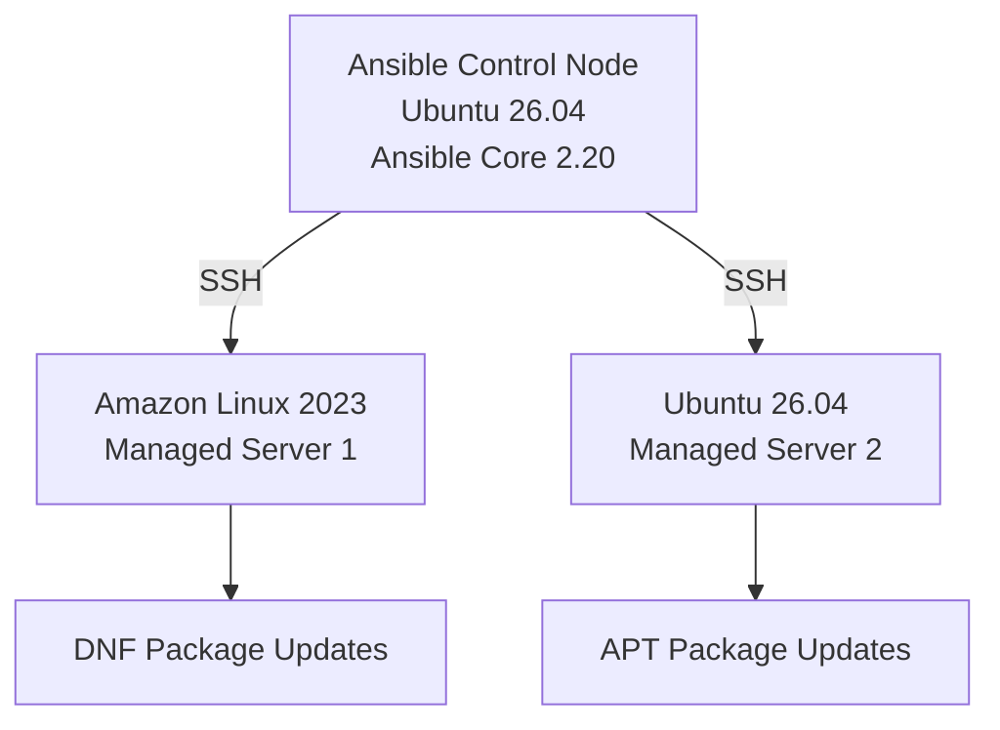
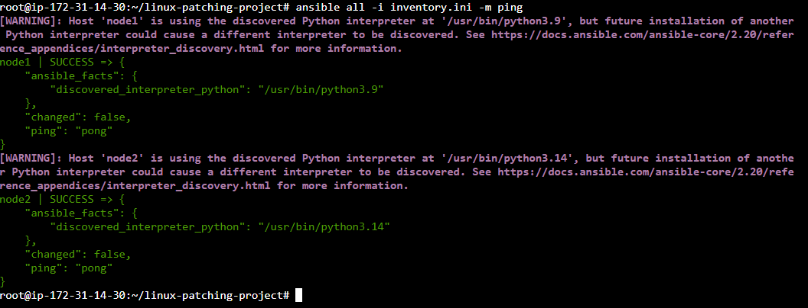

# Automated Linux Server Patching Using Ansible

## Project Overview

This project automates Linux server package patching
using Ansible from a centralized Ubuntu control node.

It supports both Ubuntu and Amazon Linux servers.

## Architecture

- Control Node: Ubuntu 26.04 LTS
- Managed Server 1: Amazon Linux 2023
- Managed Server 2: Ubuntu 26.04 LTS
- Automation Tool: Ansible

### Architecture Diagram

## Technologies Used

- AWS EC2
- Linux Administration
- Ansible
- YAML
- SSH
- APT Package Manager
- DNF Package Manager
- Git and GitHub

## Project Features

- Centralized management of multiple Linux servers
- Supports Ubuntu and Amazon Linux
- Displays hostname and operating system details
- Updates Ubuntu APT package cache
- Upgrades Ubuntu packages
- Upgrades Amazon Linux packages using DNF
- Displays patching change status

## Project Structure

    linux-patching-project/
    ├── README.md
    ├── inventory.example.ini
    ├── patching.yml
    └── .gitignore

## Prerequisites

- Ansible installed on the control node
- SSH connectivity to managed servers
- Sudo privileges on managed servers
- Python installed on managed servers

## Configuration

1. Clone this repository.
2. Copy the sample inventory:

   cp inventory.example.ini inventory.ini

3. Update inventory.ini with your actual server IP addresses.
4. Configure the SSH private key path securely.

## Validate Playbook

    ansible-playbook -i inventory.ini patching.yml --syntax-check

## View Target Servers

    ansible-playbook -i inventory.ini patching.yml --list-hosts

## Run Patching

    ansible-playbook -i inventory.ini patching.yml

## Important Notes

- Review pending updates before production patching.
- Take backups or snapshots before patching.
- Test the playbook in a non-production environment.
- Plan server reboot separately when required.
- Never upload SSH private keys or production credentials to GitHub.

## Author

DevOps / Linux Administration Learning Project

## Project Evidence

### Ansible Connectivity Check

This screenshot shows successful Ansible connectivity with both managed Linux servers.

